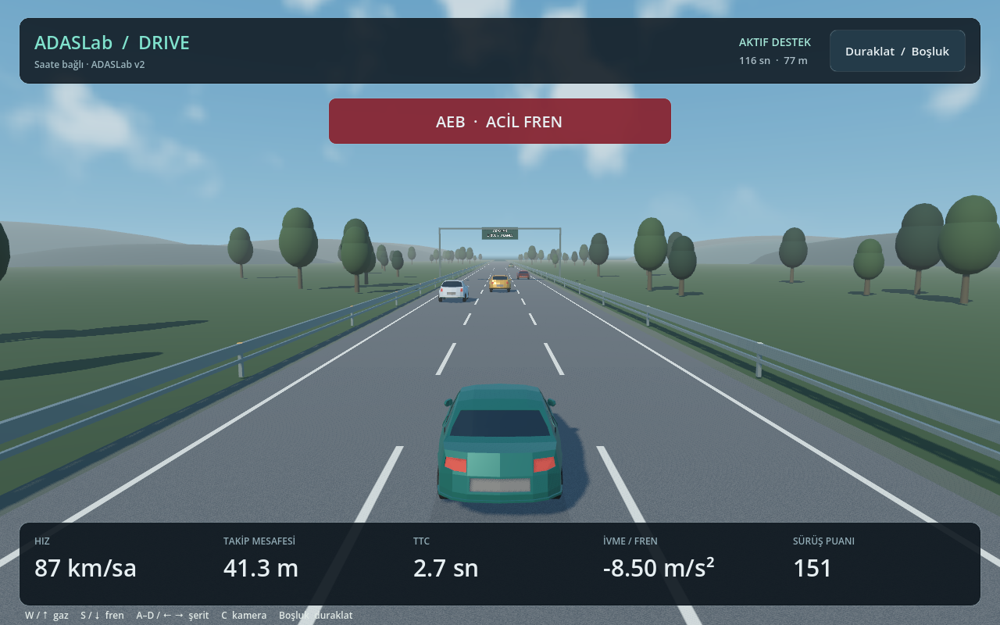

# ADASLab Drive — isteğe bağlı bağımsız prototip

**Güncel normal kullanım Studio içindeki 3B Sürüş sayfasıdır; `Start.command --game` da Studio açar.** Bu klasör önceki bağımsız Godot prototipinin geliştirici kaynaklarını korur. Aşağıdaki bilgiler yalnız ayrıca derlenen bağımsız paket içindir. macOS release uygulaması USB seri portuna kendi yerel eklentisiyle doğrudan bağlanır. ADAS modu, ACC, hedef hız, takip süresi ve başlat/duraklat isteğinin kaynağı saatteki ADASLab v2 firmware'idir.

## Kullanım

1. Saati ST-LINK USB girişinden bağlayın.
2. Kullanıcı Uygulamaları klasöründeki **ADASLab Drive.app** uygulamasını açın. Spotlight ile de bulunabilir.
3. Saat ekranından modu, ACC'yi, hedef hızı ve takip süresini seçin; **BASLAT** düğmesine dokunun.
4. Bilgisayarda W/↑ gaz, S/↓ fren, A–D/←→ şerit, Boşluk/Esc duraklatma, C/F kamera değişimidir.

Oyunun menüsü saatteki ADAS ayarlarını yalnız gösterir. **Yolu sıfırla** yeni trafik sürüşünü hazırlar; sürüşü tekrar saatten başlatın. Pencere odağı kaybolunca, USB kesilince veya uygulama kapanınca tuşlar bırakılır ve saate duraklatma gönderilir. Yeniden bağlantı eski sürüşü otomatik sürdürmez. USB portu gerekirse menüden seçilebilir.

Saatte **ADASLab v2 veya v3 / DeviceBoot v2** yeterlidir. Bu prototip kör nokta sensörlerini (`N:`) göndermez; kör nokta, şerit takip ve yan/arka önleme yalnız Studio'daki sürüştedir, A/D burada eskisi gibi şerit değiştirir. Studio artık kendi 3B sürüş sahnesini de içerir; bu bağımsız paket Studio başlatıcısından açılmaz.

## Mimari

- Godot ana iş parçacığı: 3B sahne, kamera, HUD ve klavye.
- Godot arka plan işçisi: tek sahipli USB bağlantısı ve onaylanan örnekten sonra 50 ms trafik fiziği adımı.
- Yerel C++ GDExtension: işletim sisteminin seri port API'si. macOS'ta özel TTY sahipliği, sınırlı okuma ve yazma kullanılır.
- Saatte C: FCW/AEB/ACC kararları ve ayarlar. Oyunda yerel TTC/AEB denetleyicisi kopyası bulunmaz.

Görüntü, ardışık onaylanmış konumlar arasında yumuşatılır. Eski kontrol cevabıyla fizik ilerletilmez. Yerel işçi, ana pencerenin güncelliğini de izler; pencere takılırsa sürüş durur. Saatin mevcut 500 ms veri eskime koruması ayrıca korunur. Normal oyunda TCP sunucusu veya yardımcı Python işlemi yoktur.

## Geliştirici derlemesi

Doğrulanan paket hedefi macOS Apple Silicon'dur. Windows/Linux için bu görevde yerel paket üretilmedi.

```sh
.venv/bin/python tools/install_godot.py
.venv/bin/python -m pip install scons==4.11.1
.venv/bin/python tools/build_standalone.py --install
```

Derleyici Xcode Command Line Tools içinden gelir. Betik resmi Godot 4.7.2 release şablonunu SHA512 ile doğrular; Godot C++ 4.5 SDK'sını proje `.tools` dizininde kullanır. Yerel kütüphane derlenir, release oyun paketi oluşturulur, Apple Silicon yürütülebiliri ve yerel ad-hoc imzası doğrulanır. `--install`, paketi `~/Applications/ADASLab Drive.app` konumuna kopyalar. Bu yerel imza App Store/notarization dağıtımı değildir.

Kaynak dosyalar: `native_host.gd` (USB/saat sahibi), `native_world.gd` (trafik), `main.gd` (görünüm), `native/serial/serial.cpp` (yerel seri port).

## Test

```sh
# Saf yerel trafik/protokol testleri; fiziksel karta erişmez:
.tools/godot/Godot.app/Contents/MacOS/Godot --headless --path godot/adas_drive --script "$PWD/tests/godot/native_world_test.gd"
# Kurulu gerçek release uygulaması + gerçek saat; Flash'a yazmaz:
.venv/bin/python tools/verify_standalone.py --app "$HOME/Applications/ADASLab Drive.app" --port /dev/cu.usbmodem11403
```

Portu kendi cihazınıza göre değiştirin ve testten önce açık oyunu kapatın. Testler normal Godot giriş hattına sentetik klavye olayları gönderir; saat paneli istekleri mevcut firmware protokolüyle uygulanır. Fiziksel parmak dokunuşu otomatikleştirilmez.

Eski Studio/TCP ve ARM karşılaştırma akışı yalnız geliştirici teşhisi olarak kaynakta korunur. Normal uygulama açılışının bağımlılığı değildir. Varlık lisansları [assets/ATTRIBUTION.md](adas_drive/assets/ATTRIBUTION.md) içindedir.

2026-10-29 doğrulaması: 100 Python/Studio regresyon testi, 14 yerel trafik/protokol kontrolü ve kurulu gerçek release paketiyle 18 saat/oyun kontrolü geçti. `debug_build=false`, doğrudan USB, bağımsız çalışma dizini, imza ve kapanışta MCU duraklatma doğrulandı. Ayrıntılar [standalone-verification.json](../standalone-verification.json) içindedir.


